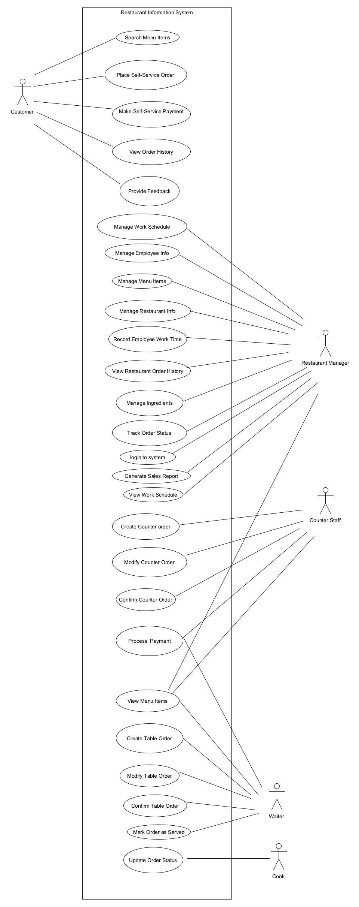
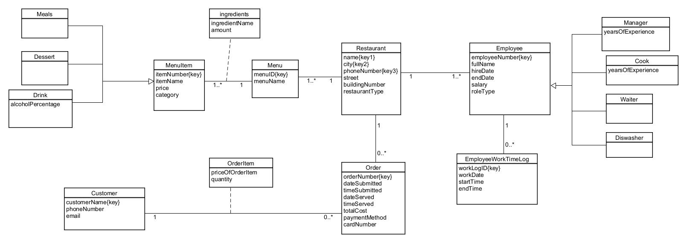
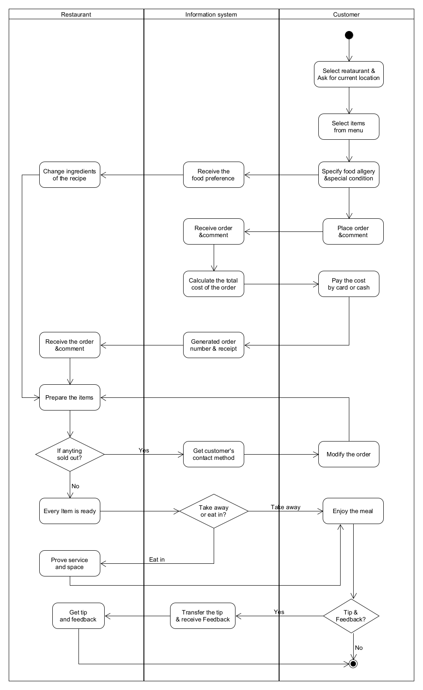
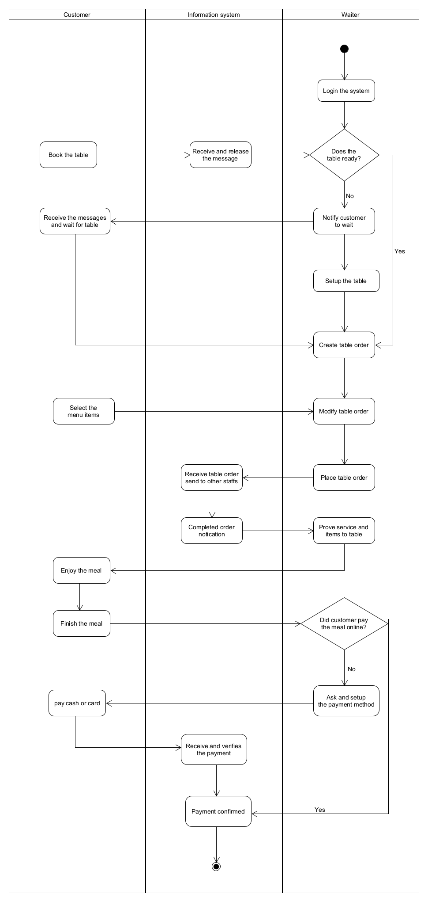
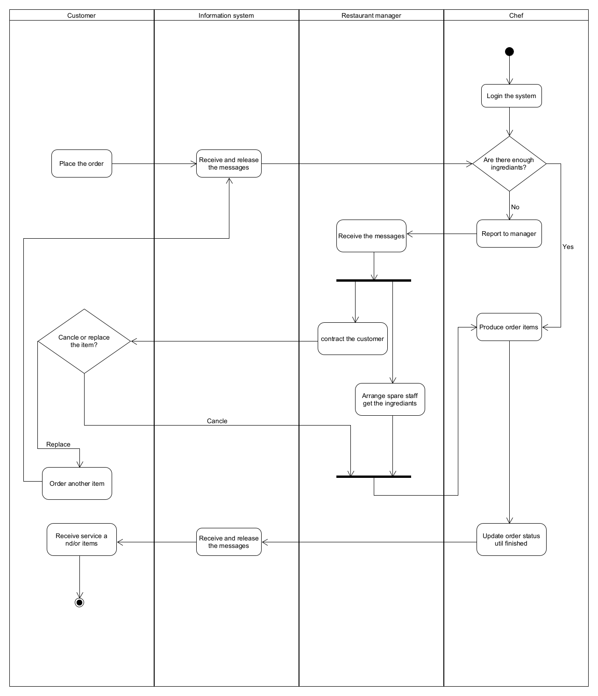
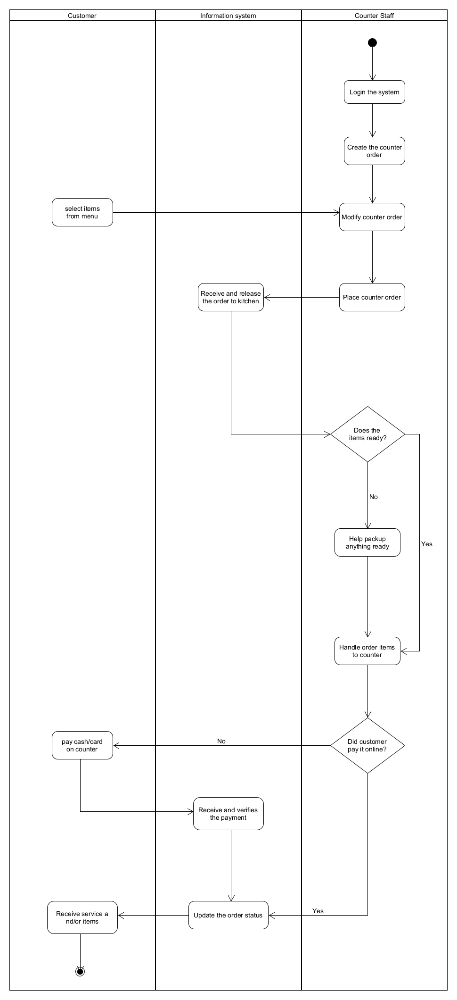
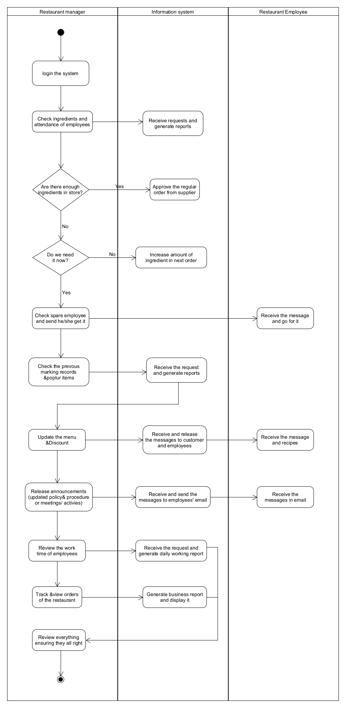

# Restaurant Chain Information System: Systems Analysis

A full systems-analysis proposal for a restaurant chain with multiple outlets. It covers one integrated system for
employees, menus and customer orders, from the business problem and stakeholders through feasibility and cost/benefit
to UML models of the proposed system.

> Group project (Group 7) for **CSIT114 Systems Analysis**, University of Wollongong (Autumn 2025).
> 📄 [Read the report (PDF, 76 pages)](report/systems-analysis-report.pdf)

## Diagrams

| Use case diagram | Domain model class diagram |
|---|---|
|  |  |

Activity diagrams: customer, waiter, chef, counter staff, manager

The `.uxf` files are the editable sources and open in [UMLet](https://www.umlet.com/).

## My contribution

- **System vision:** I wrote the System Vision Document, covering the problem statement, the proposed system's
  capabilities and the business benefits for the client.
- **Stakeholder analysis:** I led the identification of internal and external stakeholders (restaurant manager, cook,
  customers and others), analysed their interests and influence, and set the engagement strategy.
- **Use cases and UML:** I wrote the fully developed use case descriptions for the *Customer* and *Restaurant Manager*
  actors, and co-authored the use case diagram and the domain model class diagram.
- **Feasibility and cost/benefit:** I estimated development costs (personnel, hardware, software) and projected the annual
  tangible benefits. I also calculated the project's net present value (NPV) and payback period.

## Team

Group 7: Zihua (Andy) Zeng, Phuong Anh Phan, Khodedah Shadman, Yiheng Huang.
